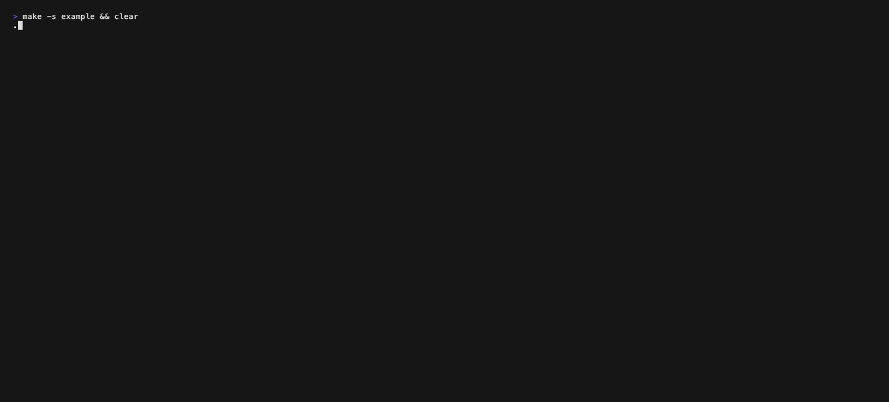

# Fancy Tree

## The right way to log a binary search tree



A single header that prints any binary tree in your terminal, vertically (root on top) or horizontally (root on the left). C++11, no dependencies.

## How to use fancy tree

Copy `src/fancy_tree.hpp` into your project and include it after your node definition.

With a node that has `_left`, `_right` and `_value` members (like `src/test.hpp`), nothing else is needed:

```c++
template <typename T>
class Node {

	public:
		T			_value;
		Node<T>		*_left;
		Node<T>		*_right;
		Node<T>		*_parent;

		Node(T value)
		{
			this->_value = value;
			this->_left = nullptr;
			this->_right = nullptr;
			this->_parent = nullptr;
		}
};
```

```c++
#include "test.hpp"
#include "fancy_tree.hpp"

fancy_tree<Node<int> > tree;
tree.print_tree(root, V_VIEW);  // vertical view, root on the top
tree.print_tree(root, H_VIEW);  // horizontal view, root on the left
```

If your node uses other member names, define them before the include:

```c++
struct my_node {
	std::string	key;
	my_node		*left;
	my_node		*right;
};

#define FANCY_TREE_LEFT left
#define FANCY_TREE_RIGHT right
#define FANCY_TREE_VALUE key
#include "fancy_tree.hpp"

fancy_tree<my_node> tree;
```

Any value type works as long as it can be printed with `operator<<` (numbers, `std::string`, your own types). In the vertical view values get 6 characters; longer values are cut and end with `…`. The horizontal view always prints the full value.

## Output

The tree built in `src/test.cpp`:

* Vertical view `print_tree(root, V_VIEW);`

```log
                                                                           ┌──────┐
                                      ┌────────────────────────────────────┤  38  ├────────────────────────────────────┐
                                      │                                    └──────┘                                    │
                                      │                                                                                │
                                   ┌──┴───┐                                                                        ┌───┴──┐
                  ┌────────────────┤  26  ├────────────────┐                                      ┌────────────────┤  70  ├────────────────┐
                  │                └──────┘                │                                      │                └──────┘                │
                  │                                        │                                      │                                        │
               ┌──┴───┐                                ┌───┴──┐                                ┌──┴───┐                                ┌───┴──┐
        ┌──────┤  6   ├──────┐                  ┌──────┤  15  ├──────┐                  ┌──────┤  43  │                         ┌──────┤  88  ├──────┐
        │      └──────┘      │                  │      └──────┘      │                  │      └──────┘                         │      └──────┘      │
        │                    │                  │                    │                  │                                       │                    │
     ┌──┴───┐            ┌───┴──┐            ┌──┴───┐            ┌───┴──┐            ┌──┴───┐                                ┌──┴───┐            ┌───┴──┐
     │  3   │          ┌─┤  15  │            │  27  │            │  36  │            │  40  │                                │  85  │            │  89  │
     └──────┘          │ └──────┘            └──────┘            └──────┘            └──────┘                                └──────┘            └──────┘
                       │
                    ┌──┴───┐
                    │  12  │
                    └──────┘
```

* Horizontal view `print_tree(root, H_VIEW);`

```log
            ┌──┤89
        ┌──┤88
        │   └──┤85
    ┌──┤70
    │   └──┤43
    │       └──┤40
──┤38
    │       ┌──┤36
    │   ┌──┤15
    │   │   └──┤27
    └──┤26
        │   ┌──┤15
        │   │   └──┤12
        └──┤6
            └──┤3
```

## Development

```sh
make test      # builds with -Wall -Wextra -Werror and compares the output with tests/*.txt
make example   # builds src/test.cpp
```

If you change the drawing on purpose, regenerate the expected output with `make example edge && ./example > tests/example.txt && ./edge > tests/edge.txt`. Record the gif again with [vhs](https://github.com/charmbracelet/vhs): `vhs assets/sample.tape`.

## License

[MIT](LICENSE)
