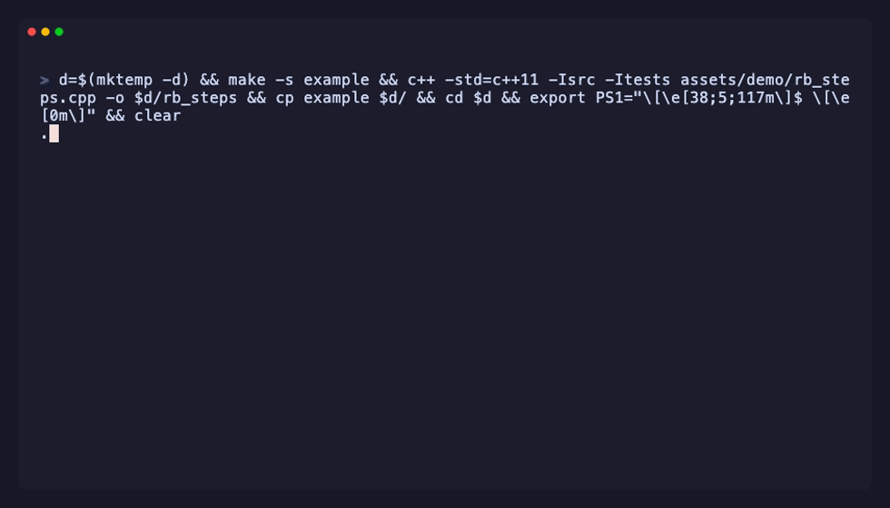
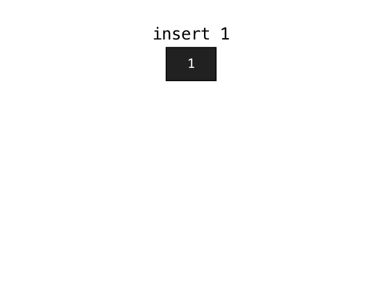
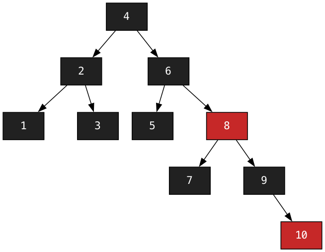

<div align="center">

# Fancy Tree

**The right way to log a binary tree.**
One C++11 header that draws any binary tree in your terminal, colours red-black trees, and exports to Graphviz.

[](https://github.com/0xShady/fancy-tree/actions/workflows/ci.yml)
[](https://github.com/0xShady/fancy-tree/releases)
[](https://github.com/0xShady/fancy-tree/stargazers)
[](LICENSE)


</div>

## Contents

- [Features](#features)
- [Quick start](#quick-start)
- [Your node](#your-node)
- [The two views](#the-two-views)
- [Values](#values)
- [Red-black trees](#red-black-trees)
- [Graphviz export](#graphviz-export)
- [Tips](#tips)
- [Reference](#reference)
- [Limits](#limits)
- [Upgrading from v1](#upgrading-from-v1)
- [Development](#development)

## Features

- 🌳 **Two views**: vertical with boxes (root on top) or compact horizontal (root on the left).
- 🧩 **Any node type**: name your node's fields with three macros, no header to edit.
- 🔤 **Any value type** that `operator<<` can print: numbers, strings, accents, your own types.
- 🔴 **Red-black trees** drawn in red and black, with a plain fallback when piped to a file.
- 🖼️ **Graphviz export** to PNG or SVG, for trees too big for the terminal.
- 📦 **One header**, C++11, no dependencies, builds clean with `-Wall -Wextra -Werror`.

## Quick start

**1. Get the header:**

```sh
curl -O https://raw.githubusercontent.com/0xShady/fancy-tree/v2.0.0/src/fancy_tree.hpp
```

**2. Include it after your node definition and print:**

```c++
#include "node.hpp"          // your node, with _left, _right and _value
#include "fancy_tree.hpp"

fancy::tree<Node<int> > printer;
printer.print_tree(root, fancy::V_VIEW);   // vertical view
printer.print_tree(root, fancy::H_VIEW);   // horizontal view
```

That is all. `print_tree` takes a pointer to the root, writes to `std::cout`, and prints `Tree is empty!` for a null root.

## Your node

Fancy Tree reads three fields from each node: the left child, the right child and the value. Missing children must be `nullptr`. A parent pointer, if you have one, is ignored.

**Default names.** A node with `_left`, `_right` and `_value` works as is:

```c++
template <typename T>
struct Node {
	T		_value;
	Node	*_left;
	Node	*_right;
};
```

**Your own names.** Define them before the include:

```c++
struct word {
	std::string	key;
	word		*left;
	word		*right;
};

#define FANCY_TREE_LEFT left
#define FANCY_TREE_RIGHT right
#define FANCY_TREE_VALUE key
#include "fancy_tree.hpp"

fancy::tree<word> printer;
```

The macros are read once per file, so each `.cpp` file can only describe one set of names.

## The two views

### Vertical: `fancy::V_VIEW`

The root sits on top, each node in a box, children below. Easy to read, but each level doubles the width (see [Limits](#limits)).

```log
                                                                           ┌──────┐
                                      ┌────────────────────────────────────┤  38  ├────────────────────────────────────┐
                                      │                                    └──────┘                                    │
                                      │                                                                                │
                                   ┌──┴───┐                                                                        ┌───┴──┐
                  ┌────────────────┤  26  ├────────────────┐                                      ┌────────────────┤  70  ├────────────────┐
                  │                └──────┘                │                                      │                └──────┘                │
                  │                                        │                                      │                                        │
               ┌──┴───┐                                ┌───┴──┐                                ┌──┴───┐                                ┌───┴──┐
        ┌──────┤  6   ├──────┐                  ┌──────┤  15  ├──────┐                  ┌──────┤  43  │                         ┌──────┤  88  ├──────┐
        │      └──────┘      │                  │      └──────┘      │                  │      └──────┘                         │      └──────┘      │
        │                    │                  │                    │                  │                                       │                    │
     ┌──┴───┐            ┌───┴──┐            ┌──┴───┐            ┌───┴──┐            ┌──┴───┐                                ┌──┴───┐            ┌───┴──┐
     │  3   │          ┌─┤  15  │            │  27  │            │  36  │            │  40  │                                │  85  │            │  89  │
     └──────┘          │ └──────┘            └──────┘            └──────┘            └──────┘                                └──────┘            └──────┘
                       │
                    ┌──┴───┐
                    │  12  │
                    └──────┘
```

### Horizontal: `fancy::H_VIEW`

The root sits on the left; the right subtree is drawn above it and the left subtree below. One line per node, so it fits deep trees and shows values in full.

```log
            ┌──┤89
        ┌──┤88
        │   └──┤85
    ┌──┤70
    │   └──┤43
    │       └──┤40
──┤38
    │       ┌──┤36
    │   ┌──┤15
    │   │   └──┤27
    └──┤26
        │   ┌──┤15
        │   │   └──┤12
        └──┤6
            └──┤3
```

## Values

Anything `operator<<` can print works as a value. In the vertical view a value gets 6 characters, centred; longer ones are cut and end with `…`. Accents and other UTF-8 characters count as one character. The horizontal view always prints the full value.

**Maps and pairs.** For a node holding a `std::pair`, declare an `operator<<` for it **before** including `fancy_tree.hpp`:

```c++
template <typename K, typename V>
std::ostream	&operator<<(std::ostream &out, const std::pair<K, V> &p)
{
	return (out << p.first << ":" << p.second);
}

#include "fancy_tree.hpp"
```

```log
     ┌──────┐
   ┌─┤ 2:bb │
   │ └──────┘
   │
┌──┴───┐
│ 1:a  │
└──────┘
```

For your own pair type (`ft::pair`), you can also put the `operator<<` in the same namespace as the type, anywhere.

## Red-black trees



Tell Fancy Tree which member holds the colour and which value means red, and red nodes are drawn in red in both views:

```c++
#define FANCY_TREE_COLOR _color   // the member holding the colour
#define FANCY_TREE_RED RED        // the value that means red
#include "fancy_tree.hpp"
```

| Your colour member | `FANCY_TREE_RED` |
| --- | --- |
| `enum color { RED, BLACK } _color;` | `RED` |
| `bool is_red;` | `true` |
| `bool black;` | `false` |
| `char c;` (`'R'` or `'B'`) | `'R'` |

Forgetting `FANCY_TREE_RED` stops the build with a message saying so.

**Without colours.** When the output is not a terminal (piped to a file or to `less`), or `NO_COLOR` is set, red nodes get double-line boxes in the vertical view and `(red)` in the horizontal view, so the log stays readable:

```log
               ┌──────┐
        ┌──────┤mango ├──────┐
        │      └──────┘      │
        │                    │
     ╔══╧═══╗            ╔═══╧══╗
     ║apple ╟─┐          ║zucch…║
     ╚══════╝ │          ╚══════╝
              │
          ┌───┴──┐
          │ kiwi │
          └──────┘
```

```log
    ┌──┤zucchini (red)
──┤mango
    │   ┌──┤kiwi
    └──┤apple (red)
```

| Environment | Effect |
| --- | --- |
| *(nothing)* | Colours in a terminal, double boxes when piped |
| `NO_COLOR=1` | Never colours |
| `CLICOLOR_FORCE=1` | Colours even when piped, for example to `less -R` |

## Graphviz export



`print_dot` writes the tree in [DOT](https://graphviz.org/doc/info/lang.html), the text format of Graphviz, which turns it into an image. Values are never cut, a lone child stays on its side, and red-black nodes are filled red or black.

```sh
brew install graphviz      # or: sudo apt install graphviz
```

```c++
#include <fstream>

std::ofstream file("tree.dot");
printer.print_dot(root, file);   // or printer.print_dot(root) for std::cout
```

```sh
dot -Tpng tree.dot -o tree.png && open tree.png
dot -Tsvg tree.dot -o tree.svg      # zoomable, best for big trees
```

**Watch your algorithm step by step.** Write one file per operation, then turn them into images or a gif, like the one above:

```c++
for (int i = 1; i <= 8; i++)
{
	insert(root, i);
	char name[32];
	std::snprintf(name, sizeof(name), "step_%02d.dot", i);
	std::ofstream file(name);
	printer.print_dot(root, file);
}
```

```sh
for f in step_*.dot; do dot -Tpng "$f" -o "${f%.dot}.png"; done
magick -delay 100 step_*.png -background white -gravity north -extent 600x400 -loop 0 steps.gif
```

The images grow with the tree, so `-extent` puts every frame on the same canvas: make it at least as big as the last image. `assets/dot-steps.sh` in this repo does it all, with a title on each frame.



## Tips

- **Print after each step while debugging.** A `print_tree(root, fancy::H_VIEW)` after every insert or erase shows exactly which rotation went wrong.
- **Big tree?** Use the horizontal view, or `print_dot` and an SVG.
- **Logs and diffs.** Piped output has no colour codes, so you can save it (`./tests > tree.txt`) and `diff` it against a known good drawing, like this repo's tests do.
- **One printer per node type.** `fancy::tree<Node>` holds no tree of its own; keep one around and pass it any root.

## Reference

| Name | What it is |
| --- | --- |
| `fancy::tree<Node>` | The printer, for one node type |
| `print_tree(const Node *root, fancy::view v)` | Draws the tree on `std::cout` |
| `fancy::V_VIEW`, `fancy::H_VIEW` | The two views |
| `print_dot(const Node *root, std::ostream &out = std::cout)` | Writes the tree in DOT |
| `FANCY_TREE_LEFT`, `FANCY_TREE_RIGHT`, `FANCY_TREE_VALUE` | Node field names. Default `_left`, `_right`, `_value` |
| `FANCY_TREE_COLOR`, `FANCY_TREE_RED` | Colour member and the value that means red. Optional |
| `NO_COLOR`, `CLICOLOR_FORCE` | Environment variables that turn colours off or on |

## Limits

- The vertical view doubles in width at each level: 5 levels need about 160 columns, 6 levels about 320. Past that, use the horizontal view or Graphviz.
- Missing children must be `nullptr`. Trees that use a shared sentinel node instead (a `_nil` leaf) are not supported yet.
- `print_tree` always writes to `std::cout`; `print_dot` takes any stream.
- Drawing is recursive, so a degenerate tree tens of thousands of levels deep can overflow the stack.

## Upgrading from v1

v2.0.0 renamed things, so v1 code needs three small changes:

- `fancy_tree<Node>` is now `fancy::tree<Node>`.
- `V_VIEW` and `H_VIEW` are now `fancy::V_VIEW` and `fancy::H_VIEW`.
- Undo your edits to `fancy_tree.hpp` (the include and the `NODE`, `LEFT`, `RIGHT`, `CONTENT` macros) and use the `FANCY_TREE_*` macros instead.

See the [release notes](https://github.com/0xShady/fancy-tree/releases/tag/v2.0.0).

## Development

```sh
make test       # builds with -Wall -Wextra -Werror and compares the output with tests/*.txt
make graphviz   # checks that Graphviz accepts the DOT output (needs dot)
make example    # builds src/test.cpp
```

If you change the drawing on purpose, regenerate the expected output with `make example edge rb rb_bool dot_export && ./example > tests/example.txt && ./edge > tests/edge.txt && ./rb > tests/rb.txt && CLICOLOR_FORCE=1 ./rb > tests/rb_colour.txt && ./rb_bool > tests/rb_bool.txt && ./dot_export > tests/dot_export.txt`.

The recordings come from [vhs](https://github.com/charmbracelet/vhs) tapes and a script, so they can be made again: `vhs assets/sample.tape`, `vhs assets/red-black.tape`, and `assets/dot-steps.sh` (needs Graphviz and ImageMagick).

CI runs the tests on Ubuntu and macOS, plain and with AddressSanitizer and UndefinedBehaviorSanitizer, and checks the DOT output with Graphviz.

## License

[MIT](LICENSE)
